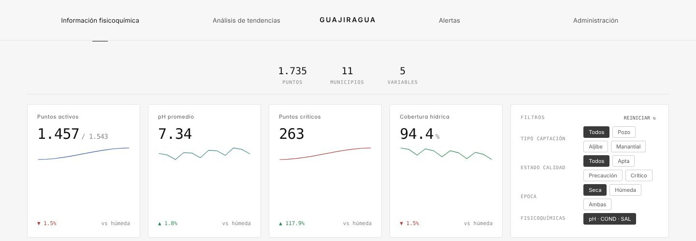
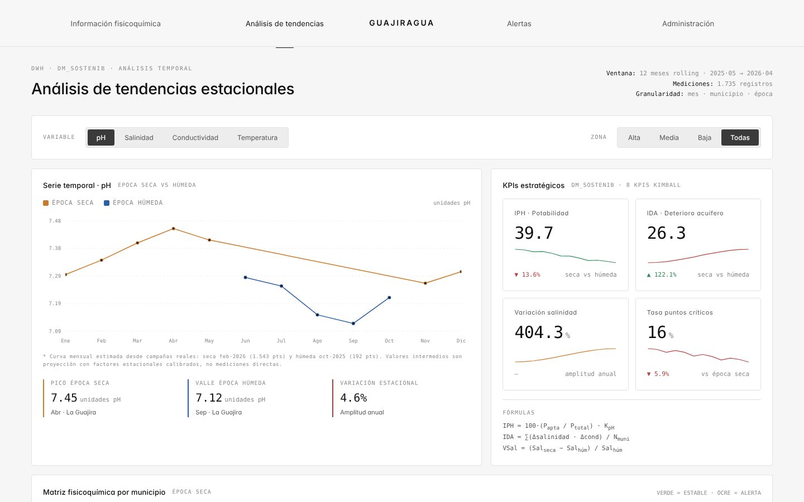
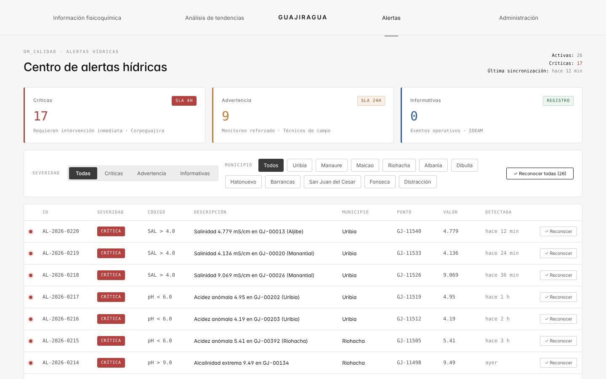
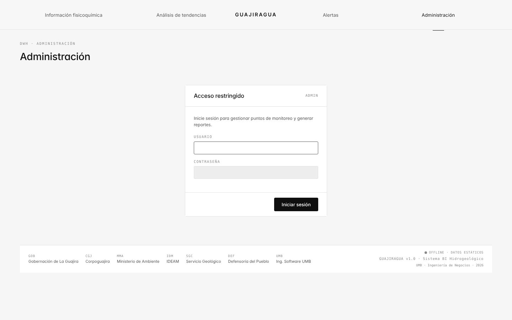
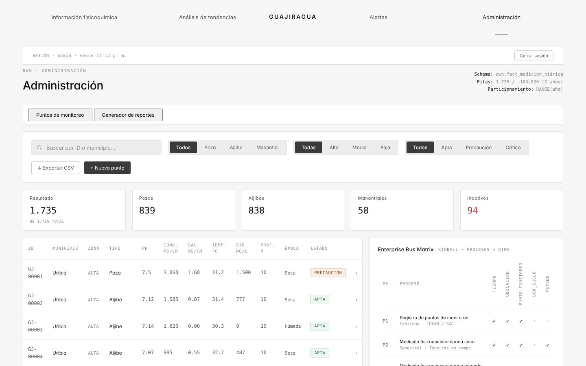

# Guajiragua

Sistema de inteligencia de negocios para el monitoreo de la calidad del agua subterránea en el departamento de La Guajira, Colombia.

Integra 1.735 mediciones fisicoquímicas de pozos, aljibes y manantiales de 11 municipios en una bodega de datos con modelo estrella. Las expone mediante una API REST y las presenta en un tablero web con mapa, tendencias estacionales, alertas por umbral y generación de reportes.

Proyecto académico del programa de Ingeniería de Negocios de la Universidad Manuela Beltrán (UMB), desarrollado con la metodología de bodegas de datos de Kimball.

- Aplicación: https://majestic-biscuit-1790f6.netlify.app
- API: https://guajiragua.onrender.com (documentación interactiva en `/docs`)



## Contenido

1. [Arquitectura](#arquitectura)
2. [Datos](#datos)
3. [Modelo dimensional](#modelo-dimensional)
4. [Indicadores y reglas de clasificación](#indicadores-y-reglas-de-clasificación)
5. [Estructura del repositorio](#estructura-del-repositorio)
6. [Instalación local](#instalación-local)
7. [Configuración](#configuración)
8. [Despliegue](#despliegue)
9. [API](#api)
10. [Autenticación](#autenticación)
11. [Limitaciones conocidas](#limitaciones-conocidas)
12. [Capturas](#capturas)

## Arquitectura

```
 Fuente (CSV)           Bodega de datos            Servicio               Presentación
 ─────────────          ───────────────            ────────               ────────────
 Mapa_PH_Guajira  ──►   PostgreSQL (Supabase)  ──► API REST (FastAPI) ──► Aplicación web (React)
                        modelo estrella            Render                 Netlify
                        funciones SQL de           autenticación          mapa, tendencias,
                        agregación                 administrativa         alertas, reportes
                                                                              │
                        real-data.js  ◄───────────────────────────────────────┘
                        copia estática usada si la API no responde
```

| Capa | Tecnología | Ubicación |
|------|------------|-----------|
| Bodega de datos | PostgreSQL en Supabase | `api/schema.sql`, `api/create_functions.sql` |
| Carga de datos | Python, cliente Supabase | `api/load_to_supabase.py` |
| API | Python 3, FastAPI, Uvicorn | `api/` |
| Frontend | React 18, Leaflet, SheetJS; sin paso de compilación (JSX transpilado en el navegador) | raíz del repositorio |
| ETL de referencia | Python, pandas | `etl/etl_guajira.py` |

Al iniciar, el frontend consulta `GET /api/health` y descarga las mediciones paginadas desde `GET /api/puntos`. Si la API no responde en 35 segundos (margen para el arranque en frío del plan gratuito de Render), usa la copia estática `real-data.js` e indica el modo en el pie de página (`SUPABASE · LIVE` u `OFFLINE · DATOS ESTÁTICOS`).

## Datos

| Atributo | Valor |
|----------|-------|
| Fuente | `Mapa_PH_Guajira.csv` (Servicio Geológico Colombiano / Corpoguajira) |
| Mediciones | 1.735 |
| Municipios | 11: Uribia, Riohacha, Albania, San Juan del Cesar, Maicao, Manaure, Hatonuevo, Fonseca, Dibulla, Barrancas, Distracción |
| Tipos de captación | Pozo, aljibe, manantial |
| Campañas | Época seca, febrero de 2026 (1.543 mediciones); época húmeda, octubre de 2025 (192 mediciones) |
| Variables | pH, conductividad eléctrica (µS/cm), salinidad (mS/cm), temperatura (°C), sólidos totales disueltos (mg/L), profundidad (m) |
| Coordenadas | Convertidas de MAGNA-SIRGAS / Colombia Bogotá (EPSG:3116) a WGS84 |

## Modelo dimensional

Esquema estrella con una tabla de hechos al nivel de medición individual.

```
                 dim_municipio
                 id_municipio (PK)
                 nombre, zona, código DANE
                       │
 dim_punto ────── fact_medicion ────── dim_tiempo
 id_punto (PK)    id_medicion (PK)     id_tiempo (PK)
 tipo, uso,       id_punto (FK)        fecha, temporada
 método, lat,     id_municipio (FK)
 lon, prof_m,     id_tiempo (FK)
 activo           ph, conductividad, salinidad,
                  temperatura, std_mg_l, estado
```

La agregación se resuelve en la base de datos mediante funciones SQL invocadas por la API: `get_kpis`, `get_municipios`, `get_serie_base` y `get_alertas`. El diagrama completo y la matriz de bus empresarial están en `docs/modelo/`.

## Indicadores y reglas de clasificación

Cada medición tiene un estado de calidad: `Apta`, `Precaución` o `Crítico`.

Las alertas se generan con estos umbrales:

| Código | Condición | Severidad |
|--------|-----------|-----------|
| `SAL > 4.0` | Salinidad > 4,0 mS/cm | Crítica |
| `COND > 5000` | Conductividad > 5.000 µS/cm | Crítica |
| `pH < 6.0` | pH < 6,0 | Crítica |
| `pH > 9.0` | pH > 9,0 | Crítica |
| `SAL > 2.0` | 2,0 < salinidad ≤ 4,0 mS/cm | Advertencia |

Indicadores principales:

| Indicador | Definición |
|-----------|------------|
| IPH, índice de potabilidad hídrica | `100 × (mediciones aptas / total) × k_pH`, con `k_pH = (pH promedio − 5,8) / (8,5 − 5,8)` acotado entre 0 y 1 |
| IDA, índice de deterioro del acuífero | `min(100, (salinidad promedio / 3,5) × 50 + (conductividad promedio / 5.000) × 50)` |
| Cobertura hídrica | Porcentaje de puntos de captación activos |

## Estructura del repositorio

```
.
├── index.html               Punto de entrada del frontend
├── config.js                URL de la API según el entorno (local o producción)
├── api-client.js            Carga de datos, modo sin conexión y sesión administrativa
├── real-data.js             Copia estática de las 1.735 mediciones
├── mock-data.jsx            Catálogos, agregaciones e indicadores en el cliente
├── components.jsx           Componentes compartidos de la interfaz
├── map-guajira.jsx          Mapa por municipio (Leaflet)
├── page-fisicoquimica.jsx   Página: información fisicoquímica
├── page-tendencias.jsx      Página: análisis de tendencias
├── page-alertas.jsx         Página: centro de alertas
├── page-admin.jsx           Página: administración de puntos de monitoreo
├── admin-auth.jsx           Inicio de sesión de la página de administración
├── report-generator.jsx     Generador de reportes (PDF, CSV, XLSX)
├── styles.css
├── render.yaml              Definición del servicio en Render
├── start-api.bat            Arranque local de la API (Windows)
├── start-frontend.bat       Arranque local del frontend (Windows)
├── api/
│   ├── main.py              Aplicación FastAPI, CORS y registro de rutas
│   ├── auth.py              Autenticación administrativa
│   ├── crear_admin.py       Generador de credenciales del administrador
│   ├── database.py          Cliente de Supabase
│   ├── routers/             kpis, puntos, municipios, alertas, series
│   ├── schema.sql           Tablas, índices y vistas
│   ├── create_functions.sql Funciones de agregación
│   ├── load_to_supabase.py  Carga inicial de las mediciones
│   ├── requirements.txt
│   └── .env.example
├── etl/
│   └── etl_guajira.py       Pipeline ETL de referencia (extracción, transformación, carga a Excel)
└── docs/
    ├── modelo/              Diagrama del modelo estrella (draw.io y HTML)
    ├── academico/           Generadores de los entregables académicos (.docx, .pptx)
    └── capturas/
```

## Instalación local

Requisitos: Python 3.10 o superior y un proyecto de Supabase.

### 1. Base de datos

En el editor SQL de Supabase, ejecutar en orden:

1. `api/schema.sql`
2. `api/create_functions.sql`

### 2. API

```bash
cd api
python -m venv .venv
source .venv/bin/activate          # Windows: .venv\Scripts\activate
pip install -r requirements.txt
cp .env.example .env               # Windows: copy .env.example .env
```

Completar `SUPABASE_URL` y `SUPABASE_KEY` en `api/.env`. Después:

```bash
python crear_admin.py              # genera las credenciales del administrador; copiar la salida a .env
python load_to_supabase.py         # carga inicial, una sola vez
uvicorn main:app --reload --port 8000
```

La API queda en `http://localhost:8000` y su documentación en `http://localhost:8000/docs`.

### 3. Frontend

Desde la raíz del repositorio:

```bash
python -m http.server 3001
```

Abrir `http://localhost:3001`. En Windows, `start-api.bat` y `start-frontend.bat` hacen los mismos pasos.

## Configuración

Variables de entorno de la API (`api/.env` en local, panel de Render en producción):

| Variable | Obligatoria | Descripción |
|----------|-------------|-------------|
| `SUPABASE_URL` | Sí | URL del proyecto de Supabase |
| `SUPABASE_KEY` | Sí | Clave de acceso a Supabase |
| `ADMIN_USER` | Para administración | Usuario administrador |
| `ADMIN_PASSWORD_HASH` | Para administración | Hash PBKDF2-SHA256 de la contraseña; se genera con `crear_admin.py` |
| `AUTH_SECRET` | Para administración | Clave aleatoria de al menos 32 caracteres para firmar las sesiones |
| `AUTH_TTL_MIN` | No | Duración de la sesión en minutos; por defecto 60 |
| `FRONTEND_ORIGINS` | No | Orígenes adicionales permitidos por CORS, separados por coma |

`api/.env` está excluido del control de versiones y no debe subirse al repositorio.

La URL de la API que usa el frontend se define en `config.js`: `http://localhost:8000` cuando la página se sirve desde `localhost` y la URL de Render en cualquier otro caso.

## Despliegue

**API (Render).** `render.yaml` define el servicio web. Las variables `SUPABASE_URL`, `SUPABASE_KEY`, `ADMIN_USER` y `ADMIN_PASSWORD_HASH` se ingresan manualmente en el panel. `AUTH_SECRET` lo genera Render.

**Frontend (Netlify).** Sitio estático publicado desde la raíz del repositorio, sin comando de compilación. Si el dominio cambia, hay que agregarlo a la lista de orígenes de `api/main.py` o a `FRONTEND_ORIGINS`.

## API

| Método | Ruta | Descripción |
|--------|------|-------------|
| `GET` | `/api/health` | Estado del servicio y número de mediciones en la bodega |
| `GET` | `/api/kpis?temporada=` | Indicadores globales, opcionalmente por época (`Seca`, `Húmeda`) |
| `GET` | `/api/puntos` | Mediciones con filtros `temporada`, `muni`, `tipo`, `estado`, `zona`; paginación con `limit` (máx. 5.000) y `offset` |
| `GET` | `/api/municipios?temporada=` | Agregados por municipio |
| `GET` | `/api/alertas?limit=` | Mediciones en estado `Crítico` o `Precaución`, ordenadas por severidad y fecha |
| `GET` | `/api/series/{variable}?zona=` | Serie mensual de `ph`, `sal`, `cond` o `temp` |
| `POST` | `/api/auth/login` | Inicio de sesión administrativo |
| `GET` | `/api/auth/me` | Validación de la sesión actual |

Los endpoints de consulta son públicos y de solo lectura.

## Autenticación

La página de administración, que incluye el generador de reportes, exige iniciar sesión.

- Las credenciales se definen con variables de entorno. La contraseña se almacena solo como hash PBKDF2-SHA256 de 600.000 iteraciones con sal aleatoria.
- `POST /api/auth/login` devuelve un token firmado con HMAC-SHA256 y fecha de vencimiento. El cliente lo envía en la cabecera `Authorization: Bearer`.
- El frontend guarda la sesión en `sessionStorage`. La sesión termina al cerrar la pestaña, al vencer el token o con la opción de cerrar sesión.
- Tras 5 intentos fallidos desde una misma IP, o 20 en total, el inicio de sesión se bloquea durante 15 minutos.
- Los futuros endpoints de escritura deben protegerse con la dependencia `require_admin` de `api/auth.py`:

```python
from fastapi import Depends
from auth import require_admin

@router.post("", dependencies=[Depends(require_admin)])
def crear_medicion(...):
    ...
```

## Limitaciones conocidas

- **Series mensuales estimadas.** Los datos cubren dos campañas. La serie de 12 meses del análisis de tendencias se obtiene aplicando factores estacionales a los promedios de cada campaña; los meses intermedios no son mediciones directas.
- **Registro de puntos sin persistencia.** El formulario de nuevo punto de monitoreo valida los datos pero aún no los envía a la API.
- **Reportes programados.** La programación y el envío por correo de reportes no están implementados. La generación inmediata en PDF, CSV y XLSX sí funciona.
- **Alertas reconocidas.** El reconocimiento de alertas se pierde al recargar la página.
- **Valores faltantes.** En la campaña húmeda, 57 mediciones registran salinidad y sólidos disueltos en 0, y 27 mediciones tienen temperatura de 0 °C. Probablemente son datos ausentes y afectan los promedios.
- **Rendimiento del frontend.** React se carga en modo desarrollo y el JSX se transpila en el navegador. Para producción se recomienda un paso de compilación.

## Capturas

| | |
|---|---|
|  |  |
| Análisis de tendencias | Centro de alertas |
|  |  |
| Inicio de sesión administrativo | Administración de puntos de monitoreo |
